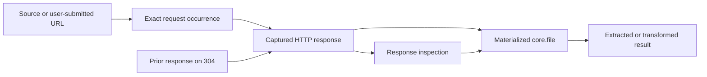

# HTTP resource Actors and customer credentials

Status: target architecture; bounded transport, request/acquisition contracts,
optional credential database component, protected executor services and shared Actor
integration implemented in an opt-in local composition; hosted rollout not qualified

## Purpose

An Aven should be able to use a URL as working material without teaching every
document, image, data, or planning Actor how to speak HTTP. A URL can become an
immutable HTTP request, one Actor can execute that request, and the exact response can
become an immutable artifact. Other Actors can then turn the response into an ordinary
file, text, JSON, an image, or a domain-specific value.

Authentication is the difficult boundary. A request artifact must be safe to retain,
inspect, and reuse, so it cannot contain an API key, cookie, bearer token, password, or
signed URL assembled from a secret. A customer-scoped Vault stores user-provided
credentials. Ordinary Actors receive a host capability to ask an **HTTP fetch Actor**
to make a bounded request. Its trusted transport independently checks permission, uses
the credential and publishes the response; no caller-facing Actor method or artifact
receives the secret.

This paper specifies that boundary. It extends the Actor, planner, and Artifact Store
model described in [Actors, skills, planning, and durable
execution](generic-actor-registry-and-runtime.md) and the exploratory flow in
[Artifact-first semantic enrichment and affordance
discovery](artifact-first-semantic-enrichment.md). It is not a description of current
HTTP-fetch behavior: the types, Actors, customer credentials component, and streaming
runtime ports below are being implemented incrementally. `@avenos/http-resources` now owns the strict
request contract, session-scoped Vault interfaces and matcher, private response-index
port, redirect-aware acquisition core, and conditional-request behavior. That core
currently resolves a plaintext attachment into its trusted host transport; it does not
yet enforce the protected HTTP executor boundary. Actor Runner also passes live
identity proof only to the active execution attempt without retaining it. The customer
credentials component is now registered as optional, with function-only roles and
durable use claims. A separate host-only HTTP executor factory verifies signed uses
and claims each exchange; it has real TLS/PostgreSQL/Qwen component evidence, but is
not connected to that older acquisition core. Set-only credential ingress now has
identity/tenant admission and redacted receipt endpoints. Connection settings and fixed
native commands have isolated native coverage for create/bind/rotate/revoke and review
denial. The opt-in local composition is not a hosted release guarantee. The protected factories publish exact raw results through the shared
Artifact Store adapter. Their first claim holds a separate physical execution marker
through shutdown and publication. The API policy module validates exact review subjects
and current versions. Its current adapters read fresh component grants, live admitted
invocations and private reviews through authenticated service boundaries. Fixed-protocol
executor entry points and optional HTTP/IMAP Actor registration are implemented, but
the full customer deployment is not yet qualified or enabled. The first response
inspection profile supports bounded UTF-8 JSON and explicitly declared plain text.
An ordinary Actor derives a file only from a matching inspection and a successful,
non-partial response. Both source occurrences remain causal inputs; processing saved
bytes never refetches. Other formats and the richer inspection policy below remain
future extensions, not current guarantees.

The acquisition core now uses a bounded HTTP/TLS transport with DNS address validation
and pinning, original-host certificate verification, a total deadline and cancellation.
Public headers are allowlisted. Credentialed cross-origin redirects remain unfollowed
observations with a typed stop reason. Compressed responses are rejected in this first
transport slice. Local tests require explicitly trusted loopback origins; request data
cannot grant that exception. These transport checks do not replace per-use authority,
durable claims, permission-partitioned cache selection or provider response policy.
The memory Vault and current response-index contract are not release-ready credential
or cache implementations. Keep them out of customer Actor installation until those
gates are met.

[IMAP mailbox Actors](imap-mailbox-actors.md) apply the same customer credential and
review boundary to mailbox queries and selected-message reads. They have separate
operation contracts and a protected IMAP executor; they do not widen HTTP fetch.

Both follow the [shared Studio catalog contract](generic-actor-registry-and-runtime.md#studio-integration):
installing their manifests, schemas, and executable offers must make eligible
capabilities available to Studio and agent authoring without a second registration.
Visibility does not grant credential use; execution, review, and provenance use the
shared runtime. Installing a manifest alone does not complete these execution boundaries.

The later Studio v2 work supplies the shared catalog and finite execution seams;
HTTP must use its trusted installation descriptors and feature/readiness checks.
The [cross-tree integration requirements](skill-studio-shared-runtime.md)
also govern bounded recall, case evidence, persistent retrieval caches, and the
separation of preview, trial, and productive execution.

The static enrichment planner expands guaranteed outputs; the observation solver
already recomputes a ready frontier from committed receipts. HTTP integration still
needs registered adapters and durable per-step claims, continuation handling, and
recovery. The planner can use a response's media type only after the response or its
inspection has committed. Receipt-driven replanning alone does not supply those
remaining durability guarantees.

## The proposed flow

The smallest useful network path has independently discoverable transformations:

```mermaid
flowchart LR
    U[web.url artifact] --> M[URL-to-request materializer]
    M --> Q[web.http-request artifact]
    Q --> H[Actor Runner admission]
    A[Application policy and required human review] --> H
    H -->|invoke with host-only authority| F[HTTP fetch Actor]
    F --> E[Protected HTTP executor]
    C[Customer credential store] -->|private secret read| E
    E --> R[web.http-response artifact and body blob]
    R --> I[Response inspector / fact projector]
    I --> P{Planner}
    P -->|image/png or other file-like body| B[Response-to-file materializer]
    B --> O[core.file artifact]
    P -->|JSON, HTML, feed, API schema...| S[Specialized materializer]
```



Here **artifact materializer** means an Actor that turns one durable representation
into another, such as HTTP response to `core.file`. It is distinct from an
`ActorFactory` materializing a live Actor instance and from a workspace adapter
materializing an artifact as a temporary path.

The HTTP fetch Actor performs one acquisition for an exact request. An acquisition
selects an existing response or makes a network observation, possibly through permitted
redirect hops. An **exchange** is one wire request and response at one hop; it is the
unit of a credential-use claim. The Actor does not crawl links, load HTML
subresources, execute JavaScript, submit forms, parse the response into a domain value,
or write a workspace file. Those are separate capabilities with their own artifacts,
limits, and authority.

Artifact-first enrichment does not turn every discovered hyperlink into network work.
Only a URL admitted as the run's source, or a URL selected through a fetch affordance,
projects `ceo.aven.web.source_url(U)`. Links extracted from HTML or documents project
`ceo.aven.web.discovered_url(U)` and remain inert until selected. This bounds eager
enrichment and keeps untrusted content from causing recursive fetches.

Both local and server execution use the normal Actor runtime. Placement is frozen in
the admitted run as it is for document Actors. The definitions and schemas are shared;
the local and server hosts provide different HTTP transports, egress policy, and
Artifact Store access. Authenticated exchange is a server-only offer. Durable
customer service credentials belong to the credentials component in the selected
customer database.

## Names and ownership

Names follow the formal specification's [ownership rules](actor-runtime-formal-spec.md#2-ownership-and-names).
These are contract names, not service addresses or deployment names. This paper
proposes the HTTP and credential contracts; it does not register them by naming them.

| Owner and namespace | Contracts owned here |
| --- | --- |
| `ceo.aven`, `web` | URL and HTTP artifacts, fetch/inspection/materialization Actors, and HTTP-specific review content |
| `ceo.aven`, `credentials` | Customer credential lifecycle, bindings, credential-use authorization, and credential policy |
| `ceo.aven`, `mail` | IMAP query/read contracts and transport-independent message/MIME artifacts, specified in the IMAP paper |
| `os.aven`, `actors` | Shared invocation, attempt, continuation, review-request, and review-decision mechanics |
| `id.aven` | Existing identity, session, and assurance evidence used by those contracts; no HTTP or customer-credential policy |

Keep `web` as the existing proposed artifact family and include the protocol in names
such as `http-request`. Do not also introduce `http.request`, `network.request`, or a
generic `core.request` for the same contract. Future mail and model operations get
names under their owning domains; they may share credential policy without pretending
to be HTTP resource reads. A provider or customer label is data, not a new namespace.
Independently owned extensions use their own reverse-DNS authority and explicit store
type bindings; they cannot claim the `ceo.aven`, `os.aven`, or existing `core.*` families.

Use these terms consistently:

| Term | Exact meaning |
| --- | --- |
| HTTP fetch Actor | The logical GET/HEAD Actor; its authenticated offer delegates to the protected HTTP executor. Avoid the unqualified “Request Actor,” which would also describe mail, payments, or model calls. |
| Protected HTTP executor | The fixed service implementation and private transport that verify authority and attach credentials. This is a deployment boundary, not another artifact type or Actor definition. |
| Customer credential store (Vault) | Protected storage owned by the customer credentials component. “Vault” is descriptive shorthand, not a generic Actor or a claim about a particular vault product. |
| Credential / secret version | A stable remote-account credential reference / one revision of its secret material. A reference carries no use authority. |
| Credential binding / binding revision | Rules selecting a credential and its typed attachment for an operation / one revision of those rules. A binding is neither a remote account nor an authorization grant. |
| Catalog capability / host capability | A named discoverable operation contract / a callable door granted to a sandbox. Neither substitutes for the policy decision required by that particular invocation. |
| Credential-use authorization / claim / audit entry | Permission for exact bounded use / durable consumption for an attempt and protocol unit, such as an HTTP hop or IMAP command / the restricted record of that use and its outcome. Do not call all three a “permit” or “receipt.” |
| Review request / review decision / approval continuation | Exact proposed work shown to a person / their verified approve, deny, or postpone decision / the runner mechanism that waits and resumes. Approval is one decision outcome, not a synonym for all three records. |
| Production run / procedure receipt | The Artifact Store's immutable successful publication record / its bounded procedure-specific `receipt` data. “Production receipt” refers to that successful record; failed attempts and credential-use audit entries stay in their operational stores. |
| Provenance / evidence | The complete recorded source and transformation chain / the Store's specific output-locator to input-locator grounding records. A URL, digest, or audit identifier alone supplies neither. |

An Actor invocation can have several execution attempts; a successful publication is
distinct from the runner's run ID, the invocation ID, and any HTTP hop. Write the full
term when crossing those boundaries. Likewise distinguish the request occurrence ID,
the store's artifact digest, the normalized HTTP request digest, and the body blob
digest. They identify different things and must not share an ambiguous `requestId` or
`digest` field in a new cross-service contract. Existing source field names remain
unchanged until an explicit adapter or versioned migration replaces them.

### Identifier forms and evolution

Catalog IDs have the form `authority:kind:namespace:name@version`. Lowercase dotted
namespaces describe stable domains; hyphenated nouns describe schemas and Actors.
Method names and predicate leaves use the runtime's existing snake_case convention.
An Actor's generated capability ID uses its method name exactly, including underscores;
do not invent a hyphenated alias. Predicate arity and argument order are part of its
meaning, even though predicate names have no `@version` suffix.

An Artifact Store type is the pair `(typeKey, typeVersion)`: `web.http-request@1` is
documentation shorthand for `("web.http-request", 1)`, not a wire `typeKey` containing
`@1`. A qualified schema ID is a separate catalog identity. Resolve it through an
explicit binding, never by splitting strings or assuming the namespaces match. The
existing `ceo.aven:schema:docs:file@1` → `core.file@1` binding is intentional.

A `schema` catalog ID describes a value contract; it does not make that value an
artifact. Credentials, authorizations, reviews, and claims remain in their designated
private channels or stores. Add an artifact type only when an immutable occurrence
needs independent reuse or causal evidence. The response-selection artifact meets
that test; a generic `web.receipt`, credential artifact, or new provenance store does
not. Procedure key/version and implementation metadata use the existing Store
procedure binding, separately from the Actor/capability ID.

Reserve catalog/schema versions for contract evolution. A registered Store type
key/version and definition digest are immutable, including changes to optional
fields; register a new type version and explicit binding when its definition changes.
Schema and Store versions are mapped, not required to have equal numbers. Deployment
versions, secret versions, binding revisions, review revisions, database migration
versions, and routing generations are separate counters. Local/server factories may
share an Actor contract but have different placement and authority requirements.
Changing a label or implementation does not justify a second contract name; changing
observable semantics requires an explicit compatible evolution or a new version.
Unknown versions and ambiguous bindings fail closed. Changing a display label never
rewrites an artifact's type or producer; conversion to another type/version publishes
a new occurrence with the original occurrence as a causal input.
Do not silently change an existing predicate's meaning or arity during schema evolution;
project a new relation when its semantics differ. New TypeScript value types use
PascalCase and fields use camelCase; include the domain where an exported noun would
otherwise be ambiguous, such as `CredentialUseClaim` or `ActorReviewDecision`.

The component ID `ceo.aven:component:data:credentials@1`, SQL schema
`aven_credentials`, and `credentials:*` action keys below supersede the earlier
unregistered `vault` proposals. No current database component or exported API is
renamed by this paper. `SessionVaultClient`, `CredentialBinding`,
`RequestScopedCredentialAttachment`, and `HttpResponseArtifact` keep their implemented
names. Map those interfaces explicitly into the proposed contracts; do not publish
both old and new identifiers for the same meaning. In particular, the attachment
type contains plaintext and belongs only inside the protected executor.

## Durable artifact vocabulary

The names below are concrete version-1 proposals. Each qualified schema ID maps to the
corresponding Artifact Store type through an application schema binding, as document
schemas do today.

| Qualified schema ID | Store type/version | Blob | Meaning |
| --- | --- | --- | --- |
| `ceo.aven:schema:web:url@1` | `web.url@1` | none | A normalized public URL plus its source kind; only an admitted source or selected link becomes fetchable |
| `ceo.aven:schema:web:http-request@1` | `web.http-request@1` | none | A retained GET/HEAD request with public headers and authentication intent; no body or credentials |
| `ceo.aven:schema:web:http-response@1` | `web.http-response@1` | required | A new network observation's effective response; includes a zero-byte blob when no body is permitted and authorized prior-body reuse on `304` |
| `ceo.aven:schema:web:http-response-selection@1` | `web.http-response-selection@1` | none | An invocation's selection of an already committed response for an exact request; no new remote observation |
| `ceo.aven:schema:web:http-response-inspection@1` | `web.http-response-inspection@1` | none | An assessment of declared and detected media, filename, safety, and materialization choices |
| `ceo.aven:schema:docs:file@1` (existing) | `core.file@1` | required | An ordinary file occurrence derived from a response and usable by existing Actors |

`web.url@1` is useful when the source has not yet committed to HTTP method, accepted
media, authentication, freshness, or redirect behavior. A deterministic materializer
turns a `source_url` into `web.http-request@1`. A skill or selected affordance may also
create the request directly. Merely extracting a URL does not establish `source_url`.

### HTTP request

A version-1 request is deliberately a resource read, not a general-purpose network
effect:

```json
{
  "method": "GET",
  "url": "https://api.example.com/reports/2026-08",
  "headers": [
    { "name": "accept", "value": "application/pdf,image/*;q=0.8" }
  ],
  "authentication": {
    "mode": "mapped-required",
    "purpose": "report-read"
  },
  "redirects": { "mode": "follow", "maximumHops": 5 },
  "freshness": "revalidate"
}
```

The schema admits only `GET` and `HEAD`. It stores normalized `https` URLs by default,
bounded non-secret request headers, and explicit policies. It rejects URL user-info and
caller-provided `authorization`, `cookie`, `proxy-authorization`, `host`, forwarding,
connection, content-length, `if-none-match`, and `if-modified-since` headers. The
executor owns conditional headers so the retained request and selected prior artifact
remain accountable. A local-development policy may admit `http` for named origins; an
artifact cannot grant that exception to itself.

Query parameters in the artifact are public request data. A bearer token, API key,
signature, session identifier, or presigned-URL parameter belongs in the credential
store and is injected at execution. Version 1 rejects URL user-info and known
secret-bearing query profiles, but key-name scanning cannot prove that arbitrary text
is non-secret. Trusted request-creation adapters, not the Artifact Store kernel, own
this boundary; opaque presigned URLs are unsupported until a provider profile can
separate their public target from credential material.

Authentication has three modes:

| Mode | Behavior |
| --- | --- |
| `anonymous` | Never attach a credential, even if a binding matches. This is the default. |
| `mapped-required` | Require exactly one authorized credential binding for the normalized request and purpose. |
| `mapped-if-present` | Use a unique authorized binding when present; otherwise remain anonymous. Policy must explicitly allow this mode because it can change server behavior. |

Version 1 has no request body. `POST`, `PUT`, `PATCH`, `DELETE`, WebDAV, GraphQL
mutation, and similar operations belong to later effect-specific Actors. They need
request/receipt artifacts, exact-action approval where applicable, idempotency keys,
and reconciliation of an ambiguous outcome. Calling a generic shell or HTTP client and
recording its exit code is not an effect receipt.

The implemented response-diagnostic helper keeps protocol meaning beside the result,
not in every conversation prompt. Capturing an HTTP error response successfully
does not establish the requested business fact. In particular, a `404` can withhold
the existence of a representation; it is not proof of absent or zero-valued data.
No-content and partial-content responses also do not establish collection coverage.
These distinctions follow [HTTP status semantics](https://www.rfc-editor.org/rfc/rfc9110.html#section-15),
especially [404 Not Found](https://www.rfc-editor.org/rfc/rfc9110.html#section-15.5.5).
The helper does not interpret body schemas, prove final user-task completion, or
authorize a retry. An eventual Actor host must retain actual status and bytes,
report consumer body availability separately, and opt its results into shared answer
review. The current conversation proof exercises that host port but does not install
the productive HTTP Actor.

### HTTP response

Every completed network acquisition produces `web.http-response@1`, including
redirect-terminal `3xx`, `4xx`, and `5xx` statuses. HTTP status is observed data, not an
Actor failure. A conditional `304 Not Modified` is the exception at the wire boundary:
it validates a previously committed representation and therefore produces an effective
response whose body reuses that prior artifact's blob. DNS, connection, TLS,
credential, policy, timeout, decompression, and size failures produce no HTTP response;
the run records a bounded typed failure and may apply its admitted retry policy.

A response payload contains bounded transport metadata:

```json
{
  "requestedUrl": "https://api.example.com/reports/2026-08",
  "finalUrl": "https://api.example.com/reports/2026-08.pdf",
  "statusCode": 200,
  "networkStatusCode": 304,
  "cacheDisposition": "revalidated",
  "representationSourceArtifactId": "prior-response-artifact-id",
  "protocol": "h2",
  "declaredMediaType": "application/pdf",
  "declaredCharset": null,
  "etag": "\"42d-aven\"",
  "lastModified": null,
  "headers": [
    { "name": "etag", "values": ["\"42d-aven\""] },
    { "name": "content-disposition", "values": ["attachment; filename=report.pdf"] }
  ],
  "redirectCount": 1,
  "storedBodyLength": 285141,
  "capturedAt": "2026-08-30T10:00:00.000Z"
}
```

`statusCode` is the effective representation status exposed to downstream Actors;
`networkStatusCode` records a different conditional status when applicable. A new
download normally has the same value in both fields and may omit
`networkStatusCode`. A newly published response's `cacheDisposition` is `new` or
`revalidated`. `fresh-cache` describes an acquisition result that selects an existing
response; it must not be written into that old response or used to mint a new capture.
The current package's `HttpCacheDisposition` union permits all three values in
`HttpResponseArtifact`; the future publication validator must enforce this distinction.
For `HEAD`, `204`, or another response that forbids a body, the stored blob and
`storedBodyLength` are zero, even when a retained representation header describes a
nonempty resource. Such a response alone cannot supply that resource's file bytes.

The primary blob contains the complete stored representation body. The executor
removes HTTP transfer framing and decodes only explicitly supported content encodings
before publication, so an image materializer receives image bytes rather than a gzip
stream. The production receipt records the received encoding and decoder
implementation. A newly downloaded response is not published when the body is
partial, exceeds a limit, fails decoding, or disagrees with the byte count enforced by
the transport. A revalidated response instead attaches the already committed blob by
artifact ID and digest; it never fabricates bytes for the empty `304` wire body.

The payload retains a small allowlist of useful headers. It never retains
`set-cookie`, authentication challenges containing sensitive parameters, proxy
headers, or credential-injected query values. Redirect locations and effective URLs
are sanitized before retention. The production run already binds the exact request
artifact as input, so the response does not duplicate provenance in an unvalidated
payload field.

The server-provided `Content-Type` is a declared media type, not detected truth. The
response inspection Actor may sniff bounded leading bytes and publish a separate
versioned assessment. It does not rewrite the response, just as file inspection does
not rewrite `core.file.declaredMediaType`.

## Existing-artifact lookup and ETag revalidation

Before opening a network connection, the execution host checks an authorized response
index for an existing `web.http-response@1` artifact. Lookup is not a global search by
URL or ETag. Its private cache partition includes:

- customer environment, execution mode, exact productive or trial scope, and
  principal or service subject;
- anonymous access or the selected Vault credential reference and secret version,
  binding revision, and credential-use/response-policy revisions;
- normalized method and URL after removing credential-injected fields;
- the values of representation-selecting request headers; and
- the prior response's `Vary` field names and corresponding request values.

An ETag is an opaque validator and is meaningful only inside that partition and cache
key. It is retained exactly, including the `W/` marker for a weak validator. `Vary: *`
makes a response ineligible for automatic reuse. `Cache-Control: no-store` prevents it
from entering the reusable response index even when product policy separately permits
the explicitly requested response artifact to be retained. `private` never broadens
the credential/principal partition, and avenOS does not share cached authenticated
responses across customers merely because an origin marks them `public`.

The default `freshness: revalidate` procedure is:

1. Normalize and authorize the request, select the authorized binding and versions
   without reading the secret, and calculate the private cache key. Recheck current
   artifact access and response-release policy even when no network request is needed.
2. Find the newest readable, complete prior response whose key and `Vary` values match.
3. If policy and HTTP freshness metadata say that artifact is still fresh, publish a
   `web.http-response-selection@1` occurrence with the current request and selected
   response as its production inputs, then return the existing response with that
   selection evidence. No network I/O or new response capture occurs.
4. Otherwise, when it has an ETag, inject `If-None-Match` with that exact validator.
   `Last-Modified`/`If-Modified-Since` is a fallback only when no ETag exists.
5. On `304 Not Modified`, validate the response against the selected candidate, merge
   permitted metadata according to HTTP cache rules, and publish a new effective
   response occurrence. Its production run declares both the current request and the
   prior response as inputs, reuses that response's exact blob through authorized
   artifact-based reuse, and records the actual `304` exchange and zero body transfer.
6. On a body-bearing response, stage and publish the new bytes. Artifact Store content
   addressing deduplicates an identical blob, while the response occurrence still
   records the new observation.

`fresh-cache` returns the existing response occurrence only after its new selection
artifact and production run commit. `revalidated` creates a new response occurrence because the
`304` is new evidence about freshness, even though both occurrences share the same
physical blob. The runner must add existing-output selection and existing-blob reuse to
its publication contract rather than downloading or base64-copying the old content.

Automatic reuse cannot cross a credential rotation or a binding/policy revision.
Keeping the same remote account does not prove that a replacement key has the same
permissions. Previously captured data remains readable only through separate artifact
access; that does not authorize returning it as the result of a new credentialed
request. The current response-index contract includes the credential reference,
secret version, binding reference/revision, host policy revision, execution placement
and exact productive/trial scope. A mismatched candidate key is rejected, not used
for conditional validation. The acquisition layer checks current request and exact
artifact access even for offline selection, and rechecks policy/credential versions
after asynchronous lookup and network exchange. Its memory Vault checks the pinned
selection synchronously at secret use. These are host-port and fixture guarantees;
the productive authorization, durable use-claim, response-index and publication
adapters remain required before customer enablement.

These rules follow the conditional request and cache-key semantics of
[HTTP Semantics](https://www.rfc-editor.org/rfc/rfc9110.html#section-13.1.2) and
[HTTP Caching](https://www.rfc-editor.org/rfc/rfc9111.html#section-4.1). The Artifact
Store remains the durable authority for which exact prior body and digest were reused.

The selection artifact records the requested freshness mode, selection time, and
whether selection was allowed by freshness metadata or by `offline-only` policy.
The acquisition result distinguishes `offline-cache` from `fresh-cache` and carries
the original capture time, new selection time and index freshness assessment. An
offline policy may select stale data; it is never relabelled as a fresh capture.
Selection time never replaces capture time, and an offline selection never
claims that the remote resource is still current. Its exact request and selected
response are declared production inputs, not merely strings in the payload.

## Streaming bytes without breaking portability

Plans, checkpoints, and envelopes are portable JSON. They cannot contain a
`ReadableStream`, `AsyncIterable<Uint8Array>`, Node buffer, open file, socket, or
Artifact Store upload authority. The current generic Artifact Store runtime port also
publishes JSON-only output drafts. HTTP acquisition therefore needs two host-owned
streaming ports:

```ts
interface ArtifactBlobReader {
  open(artifactId: string, grant: ArtifactReadGrant): Promise<ReadableStream<Uint8Array>>
}

interface ArtifactBlobStager {
  stage(
    publicationId: string,
    source: ReadableStream<Uint8Array>,
    limits: BlobLimits
  ): Promise<AttemptScopedStagedBlobHandle>
}
```

The HTTP transport yields metadata and a one-shot body stream. The host stages that
stream while enforcing byte, time, and decompression bounds. The Actor result contains
only a host-issued attempt-scoped handle. `ArtifactPublisher` consumes the handle and
atomically publishes the response artifact and production-run receipt. Neither the
handle nor any bytes enter a run record.

Downstream Actors receive the response artifact ID through their normal input slot.
When a capability needs the body, its host adapter opens an authorized byte stream
through `ArtifactBlobReader`. This is the sense in which an HTTP response is available
as a byte stream: the immutable artifact owns the bytes, while each invocation gets a
fresh, bounded stream. It is not a base64 field in the response payload.

Staging also defines the crash boundary. A retry of the same publication ID reuses the
same completed staged blob. If the process dies before staging completes, no response
artifact exists and a later `GET` may observe a newer representation. The run receipt
must not pretend that the abandoned response was committed.

## Classification and materialization

The planner should not switch on a MIME string inside a coordinator. Schema projectors
and observation Actors expose qualified facts from committed artifacts, for example:

```prolog
ceo.aven.web.source_url(U)
ceo.aven.web.http_request_anonymous(Q)
ceo.aven.web.http_request_mapped(Q)
ceo.aven.web.http_response(Q, R)
ceo.aven.web.http_response_selection(Q, S, R)
ceo.aven.web.declared_media(R, image_png)
ceo.aven.web.detected_media(R, image_png)
ceo.aven.web.materializable_file(R)
ceo.aven.docs.file(F)
```

`http_response(Q, R)` means that response `R` satisfies request `Q` under its admitted
selection policy; it does not assert a new network observation. A capture projects
that relation from its production input. Cache reuse projects it from selection
artifact `S` and its declared inputs, alongside `http_response_selection(Q, S, R)`.
A caller needing a new observation must check the production receipt and freshness
contract. Neither payload-only projectors nor a caller-supplied fact may invent these
cross-artifact relations; the generic projector needs access to committed input
evidence for this integration.

Predicate constants use catalog-safe names such as `image_png`; the artifact retains
the IANA media string `image/png`. A projector may expose the declared-media fact
directly from a schema-validated response. A byte-sniffing inspector emits
`web.http-response-inspection@1`; only its validated output projects detected-media and
safety facts. If declared and detected media disagree, policy or a specialized Actor
decides what may proceed.

The corresponding `http-response-inspector` is an `observe` Actor: it always publishes
the inspection artifact, even when its outcome is `unknown`, `mismatch`, or
`unsupported`. A result projector, rather than the inspector's coordinator, exposes
the exact facts that make a downstream materializer applicable.

The first materializers should be ordinary Actor capabilities:

| Capability | Requires | Produces |
| --- | --- | --- |
| URL to HTTP request | `ceo.aven.web.source_url(U)` | one request predicate selected by its authentication mode |
| Anonymous fetch | `ceo.aven.web.http_request_anonymous(Q)` | a new response observation or committed selection of an existing response |
| Authenticated fetch | `ceo.aven.web.http_request_mapped(Q)` plus an authorized server HTTP fetch Actor offer | a new response observation or committed selection of an existing response |
| Response to file | safe file-like response | `ceo.aven.docs.file(F)` |
| JSON response decode | detected JSON response | a typed JSON-value artifact |
| HTML response decode | detected HTML response | text/DOM/link artifacts |

The response-to-file Actor publishes a new `core.file@1` occurrence whose blob contains
the response bytes, `declaredMediaType` comes from the accepted media decision, the
filename is a sanitized `Content-Disposition` name or URL-path fallback, and
`sourceKind` is `web-response`. The production run names the response artifact and any
inspection used for the decision as inputs. Artifact Store content addressing may
reuse the physical blob, but the response and file remain distinct semantic occurrences.

A generic response-to-file Actor can accept any admitted file-like response. More
specific materializers can require `detected_media(R, image_png)`, JSON, HTML, PDF, or
a domain schema. They compete normally on cost and goal usefulness. Existing document
and image Actors can process the committed `core.file` through their ordinary input
contract. Every result must preserve its exact source chain, including the HTTP
request and response; origin-independent processing never removes provenance.

The [shared library binding rules](generic-actor-registry-and-runtime.md#artifact-library-and-exact-source-bindings)
apply to these files and their derived representations. Publish materialization as
a derivation, not through the ordinary root-file upload helper merely to make the
result appear in the library. Listing or previewing retained content cannot trigger
a refetch, and a newer library representation cannot replace an exact response,
selection or document input already bound to a plan or review.

### Provenance is a publication invariant

Every committed occurrence must identify where its bytes or values came from and the
operations that produced them. This uses the Artifact Store's existing
[production inputs and evidence](../services/artifact-store/artifact-store-spec/ARTIFACT-STORE-MINIMAL-CORE.md),
not a filename, `sourceKind` label, URL field, or matching digest as a substitute for
causal lineage. The required chain is:



The trusted publisher must enforce these requirements before exposing an output:

- Request materialization declares the exact admitted source occurrence as an input.
  A directly supplied request records the submitting principal and source kind; it
  never invents a predecessor or claims knowledge of history before submission.
- HTTP capture declares the exact request as a production input and records the
  authenticated executor, procedure and implementation versions, capture time, public
  effective URL, ordered permitted redirects, status, validator decision, and stored
  body digest/length. Decoding or sanitization decisions are versioned receipt data.
  A submitted URL proves a requested location, not remote authorship or truth.
- Every materializer declares all causal input occurrences, including inspection
  decisions, and atomically commits its outputs, producer, ordered inputs, and evidence.
  A byte-preserving file must bind the same blob digest and length as the response;
  changed bytes require a new transformation receipt describing the operation.
  Trusted host ports record additional artifact reads, child invocations, model calls,
  and configuration used in producing the result. A materializer cannot omit a source
  it actually consumed or obtain undeclared external data through an ambient network
  client. Procedure-specific publication validation enforces this input coverage.
- Structured extraction grounds each asserted source-derived field in declared inputs
  using the existing JSON-pointer, byte-range, or page-region locators. Text spans
  must map to a declared text artifact and its byte encoding. The document adapter
  verifies that a cited page and region exist; the kernel's page-region shape checks
  alone cannot establish that. An inferred
  or generated value names its inputs and method and is explicitly distinguished from
  a source quotation. Missing source evidence remains unknown or unsupported; the
  publisher must not mark such a field as verified extraction.
- A `304` run has two causal inputs: its request and the earlier body-bearing response.
  Fresh-cache selection keeps the original response occurrence and producer. The new
  invocation publishes an explicit selection artifact; it does not assign that old
  output a new producer or a new capture time. The selection names both the current
  request and selected response as inputs, including for `offline-only` reuse.
- Blob deduplication preserves separate occurrence IDs and their producers. Reusing a
  blob by authorized artifact reference still requires the causal input edge. A bare
  blob digest, or a response ID stored only in payload JSON, is insufficient.

The same rules apply through nested Skills and Source captures: bind exact Source,
Skill revision, activation, and invocation evidence when they caused the request.
Publication IDs belong to the logical invocation and stay stable across its retries;
different activations or call sites do not collapse merely because their input bytes
match. Artifact lineage remains within one scope and traversal checks access at every
hop. Exports must retain the required occurrences, receipts, and evidence; missing or
inaccessible ancestry is reported explicitly, never presented as a complete chain.

Credential values and reusable use authority never enter provenance. Restricted audit
records retain the binding/version and authorization decision; public provenance may
refer to that decision without disclosing account metadata to every artifact reader.
Provenance proves the system's recorded origin and transformation history, not that a
remote server or an extraction model told the truth.

The store already validates production inputs, supplied evidence, and authorized blob
reuse; it does not infer missing causal inputs or require field coverage automatically.
The generic runner adapter still publishes JSON-only drafts with `blob: null`, empty
evidence, and payload-only `contentDigest`. HTTP integration must carry the store's
authoritative artifact digest, occurrence ID, blob digest/length, and field evidence;
the existing payload digest does not bind a file's bytes. These checks are release
requirements for the HTTP path, not claims that its publication adapter exists today.

Response inspection is a discovery frontier. The runner commits the inspection,
projects its validated facts, and replans the unfinished suffix. It does not predict a
server's content type or execute every installed decoder speculatively.

For an exploratory URL run, `goalSpec.factFamilies` admits only the web facts and the
downstream families the skill intends to enrich, for example `ceo.aven.web` and
`ceo.aven.docs`. The exhaustive planner may run URL-to-request and fetch because the
subject is a source URL. After response inspection, checkpointed replanning can add the
matching file, JSON, or HTML materializer. The observation solver can drive such a
frontier, but the HTTP adapters and durable generic recovery remain integration work.

## Customer credentials and discoverable bindings

This proposal covers customer-provided external-service credentials used by Actors.
Their durable values belong to the proposed **customer credentials component**,
`ceo.aven:component:data:credentials@1`, in the selected customer database, outside
ordinary Actor state and artifacts. It
does not relocate installation credentials, platform-funded LLM keys, identity tokens,
or document-unlock passwords. The separate installation helper's encrypted safes and
the existing LLM gateway configuration serve those other purposes.

The component's credential store, called Vault in the existing interfaces, owns an
`aven_credentials` schema installed through the standard customer
component manifest, migrations, function roles, routing generation, isolation tests,
backup, and recovery path. The recommended first production schema stores an encrypted
secret envelope, not plaintext. Each credential version has authenticated ciphertext,
a fresh nonce, a wrapped data key, and a key version; the plaintext data key is never
stored. Authentication data binds the ciphertext to the customer environment,
owner subject, credential reference, credential type, and secret
version. The wrapping key stays outside the customer database and its backup; only
the admitted protocol executor may unwrap the selected credential for use. On the HTTP
path this is the protected HTTP executor. Key
escrow and restore must be proved before enabling this scheme. Encryption limits what
a database-only leak reveals; it does not protect a compromised protected executor
and is not end-to-end encryption. The current in-memory Vault adapter stores plaintext
and is only a contract/test foundation.

For the explicitly local development composition, the implementation plan permits a
separately selected plaintext storage adapter with a system-owned warning that database
administrators and backups can read its values. It must never be a silent fallback
when the production key backend is unavailable. Protocol isolation, set/use roles,
per-use authority, audit, and leak checks still apply. Nonlocal credential enablement
requires the envelope/key separation and restore proofs above. The HTTP memory adapter
is a test fixture, not that customer database component.

The host-only `@avenos/credential-storage` package now implements one closed storage
encoding with the pinned `jose` library: flattened JWE using `RSA-OAEP-256` and
`A256GCM`, public-key-only sealing, nonextractable private-key use, and authenticated
environment/owner/credential/type/version context. This follows
[JWE](https://www.rfc-editor.org/rfc/rfc7516.html) and
[its RSA-OAEP algorithm profile](https://www.rfc-editor.org/rfc/rfc7518.html#section-4.3).
It is not a deployed key backend or authorization service. The optional customer
component, durable claims and protected executor factories now exist; application
policy, shared review, process isolation, key provisioning/escrow and restore proof
remain required. No plaintext fallback or credential service is enabled by this package.

The set-only ingress handles a submitted value transiently and uses a key service
that grants wrapping without unwrapping, or a public-key wrapping operation. Giving
the same local symmetric wrapping key to both processes would not enforce this
separation. The protected HTTP executor receives unwrap authority for execution,
never a Vault administration role. Selecting and proving the key backend is an open
implementation prerequisite. Both paths avoid body logging and release plaintext
after the operation; garbage-collected strings do not provide provable memory erasure.

The proposed Vault schema has four kinds of durable record:

| Record | Minimum fields | Access |
| --- | --- | --- |
| Credential | owner subject, credential reference, label/type, secret version, encrypted value, nonce, wrapped data key, key version, enabled/revoked state, timestamps | Set role writes; protected executor's use role alone reads encrypted material |
| Credential binding | owner subject, binding reference and revision, credential reference, protocol discriminator, typed protocol profile, enabled state; HTTP profile contains normalized origin/path/method/purpose match and attachment rule | Set role changes; match role returns redacted descriptors |
| Credential-use claim | authorization ID, customer generation, logical invocation, attempt, protocol-defined unit kind/ordinal/digest, request identity/digests, binding and secret versions, expiry, claim/outcome state | Use function atomically claims once under a uniqueness constraint before dispatch; the HTTP unit is one exchange/hop |
| Credential-use audit entry | run/step/attempt, original caller and executor, binding/version, policy and approval decision, public target, outcome, time | Protected executor writes; customer-scoped audit readers see metadata only |

No record contains an authenticated URL with an injected query key, an applied header,
or a plaintext secret. Credential and binding references are opaque IDs, not grants.

The owner and customer environment scope these records. A replacement for another
remote account creates a new credential reference; rotation for the same account
retains it and advances its version. Public writes derive ownership from authenticated
policy, never from an unverified `ownerSubjectId` in a submitted binding. Creating a
binding does not by itself authorize any Actor to use it. Metadata discovery also
requires owner access or an explicit customer sharing policy.

Revocation and use claims serialize against the same current credential/binding state.
Once revocation commits, no later claim is allowed. An already admitted or transmitted
request may finish; cancellation is best effort and cannot recall remote bytes or
effects. Rotation similarly prevents new claims against an old version. The metadata and
match roles cannot select ciphertext; administration cannot issue network requests.
Customer restore or movement advances the routing generation and invalidates old use
authority, including claims or approvals restored from an older database snapshot.

### Interactive customer switching

Apply the [customer selection boundary](generic-actor-registry-and-runtime.md#customer-selection-is-not-execution-authority)
to Vault administration, discovery, review, and use. The native rail chooses the
interactive customer route; it is not proof of permission to use a credential.
Credential connection metadata and approvals remain customer-scoped even when the
same signed-in subject owns both environments or uses the same remote account.

Capture the customer environment when opening a set/rotate flow or review. Switching
invalidates the form and its interactive handles; late submissions and callbacks
must not resolve their destination from the new selection. A secret entered for A
must never be stored in B, and an A decision or credential reference must never
authorize a B request. Returning to A reloads metadata and requires current checks
and newly acquired handles. It does not silently restore a secret form.

An already admitted A request retains its A-scoped authority, claim, publication
destination, and policy checks. Switching does not retarget it or grant another use.
Invalidating UI handles is separate from the credential rotation/revocation and
customer movement rules above; the rail does not itself change routing generation.

### Set-only public API

Secret material enters Vault only through authenticated environment-scoped routes on
`api.aven.ceo`. The public surface supports create, rotate, revoke, and binding
management. A successful set or rotation returns only a stable credential reference,
redacted metadata, version, and timestamps.

```text
client -- set / rotate / revoke --> api.aven.ceo --> Vault --> selected customer database
                                                  ^
Actor Runner -- match only --------------------> Vault
protected HTTP executor -- use exact request --> Vault
```

The proposed component action keys are explicit below. They are tenant-grant action
strings scoped to the component, not Actor capability IDs, schema IDs, SQL function
names, or public HTTP routes. Actual functions and fixed routes must be registered
separately in the owning platform contracts.

| Action | Caller | Result |
| --- | --- | --- |
| `credentials:metadata` | Authenticated facade | Redacted credential and binding descriptors |
| `credentials:create` | Authenticated facade only | Create a credential with its initial secret version; return metadata only |
| `credentials:rotate` | Authenticated facade only | Replace the secret for the same credential reference, checking the expected version; return metadata only |
| `credentials:revoke` | Authenticated facade only | Revoke an exact credential reference/version; return metadata only |
| `credentials:binding-set` | Authenticated facade only | Create or revise a binding, checking the expected revision and access to the referenced credential |
| `credentials:binding-revoke` | Authenticated facade only | Revoke an exact binding reference/revision |
| `credentials:match` | Admitted Actor host with user authority and owner/sharing access | `none`, `ambiguous`, or one redacted binding and credential reference |
| `credentials:use` | Admitted protocol executor with user-session evidence and its protocol-specific role | Selected credential used within the exact authorized operation and claimed units; no secret-bearing response |

The proposed database role kinds are `ceo.aven:db-role:credentials:metadata@1`,
`ceo.aven:db-role:credentials:set@1`, `ceo.aven:db-role:credentials:match@1`,
`ceo.aven:db-role:credentials:use-http@1`, and
`ceo.aven:db-role:credentials:use-imap@1`. The two use roles replace the earlier
unregistered generic use-role proposal. The set role serves the facade's credential and
binding lifecycle functions; each function still verifies its exact action. These are
manifest role kinds, not physical PostgreSQL login names or Actor `ResourceId` kinds.
The customer-component catalog owns their registration; the Actor ID helper does not
admit `component` or `db-role`. No runtime role is a schema owner or can access another
component. There is no public secret-read action. Each use role reaches encrypted
material only through guarded functions for its admitted protocol/binding, never
unrestricted ciphertext table access. The unwrap service enforces the same boundary.
The protected HTTP executor uses `use-http` while executing an admitted request under
an active session; the IMAP executor uses `use-imap` for its typed operations. A dedicated transport can colocate the Vault adapter and outbound
HTTP client in one protected process so plaintext never crosses a service API. No
ordinary Actor Runner role or factory receives that use role.

There is no public or metadata API to get, reveal, export, echo, test-return, or list a
secret value. Private protocol implementations of `credentials:use` are the only
runtime secret-read paths.
A metadata list may return labels, schemes, binding patterns, enabled/revoked state,
and last-use time, but never the stored value, applied headers, cookies, query values, signing
inputs, refresh tokens, or client keys. Error responses and audit records follow the
same rule.

The facade verifies the `aven.id` evidence under the defined session-validity policy,
customer environment, entitlement, and exact Vault action. It strips forged trust headers, selects the customer route, and
issues a tenant grant addressed to Vault. Only the facade's fixed workload identity may
call Vault's set/rotate/revoke ingress. Neither Actor Runner nor an Actor receives a
database role or endpoint that can write arbitrary Vault rows.

### Capability discovery and execution authority

An ordinary Actor proposes a credential-free `web.http-request@1` occurrence. The
HTTP fetch Actor exposes an authenticated-fetch capability in the existing registry.
Seeing that offer means the operation may be planned; it grants no credential access.
The host asks application policy for execution authority after resolving the exact
request. A credential ID, a `purpose` string, a catalog capability, or an Actor's own
claim of approval cannot authorize use.

The facade/application policy boundary issues the audience-bound customer authority.
Actor Runner obtains and forwards a narrower credential-use authorization; it does not
become a new issuer of identity, entitlements, or tenant grants. The protected HTTP executor
independently verifies that authority and its authenticated calling workload. The
proposed value schema is `ceo.aven:schema:credentials:use-authorization@1`; it travels
only in the trusted host channel and has no Artifact Store type binding. Naming a
schema does not select its signing or verification protocol. That protocol must bind
the verified issuer, audience, and current authority. Its shared envelope binds a
protocol discriminator, operation capability, request schema/occurrence/store digest,
normalized operation digest, invocation, principal, generation, versions, review,
budgets, and an exact executor audience. A typed HTTP constraint branch defines the
fields below; the [IMAP branch](imap-mailbox-actors.md#shared-credentials-protocol-specific-authority)
defines mailbox/query/message constraints. Unknown branches and cross-protocol replay
fail closed. These are additions to an unregistered proposal, not an in-place change
to a published schema. For HTTP, the authorization binds:

- customer environment, current routing generation, Artifact Store scope, and subject;
- shared runtime execution mode and exact productive or trial publication scope;
- original calling Actor definition/version and parent invocation path, plus the
  authorized HTTP fetch Actor implementation and capability;
- logical invocation, attempt, exact request occurrence and authoritative artifact
  digest, and the normalized HTTP request digest;
- selected binding/revision and secret version, method, destination, purpose, allowed
  redirects, response-release policy, limits, and relevant policy revisions; and
- approval decision when required, expiry, and the allowed use/retry budget.

Original caller identity matters: another Actor running for the same person must not
inherit this credential access by routing through a more privileged HTTP fetch Actor.
The authorization evidence travels through a trusted host channel, outside Actor
payloads, artifacts, checkpoints, or prompts. Durable records retain its identifier
and decision metadata, never a reusable bearer. Policy and state are rechecked after
waiting for execution capacity and immediately before a use claim. Concurrency slots
limit simultaneous work but grant no credential access. Invocation and descendant
budgets are shared; a child cannot reset the parent's use allowance.

The protected HTTP executor owns a private Vault adapter and outbound transport. It
verifies the original user's identity proof and current customer authority, claims
one authorized attempt/hop in Vault, unwraps only that version, and attaches it while
constructing the request. Database constraints enforce one claim across replicas and
restarts. A duplicate invocation returns its recorded pending/committed outcome; it
cannot perform another exchange with the same claim. A fresh attempt requires fresh
authority within the admitted retry budget. An uncertain exchange is recorded as
uncertain; it is never represented as a successful production receipt.

The existing identity verifier checks signed JWT claims and expiry. It does not query
live session revocation. Production credential use therefore needs a defined current
session/revocation check, or an explicitly bounded validity window; the current
session ID check is not proof of immediate logout revocation. This is separate from
the Vault's transactional credential and binding revocation.

### Isolation and runtime placement

Only the protected HTTP executor's private transport can read encrypted secret material and
unwrap it. Actor methods receive request data and response handles; the plaintext
attachment stays inside that transport. A server factory can expose a proxy Actor
whose host adapter calls the fixed protected HTTP executor endpoint with forwarded authority.
It cannot resolve secrets or accept a caller-selected service endpoint. This preserves
the registry/factory model while keeping the use role and unwrap authority out of the
ordinary Actor Runner process.

The protected HTTP executor runs a fixed implementation with bounded egress. It does
not load caller-supplied code or general Actor factories and has no model port.
Untrusted Actor code uses the sandbox's granted host capabilities and has no direct
network, environment, or database access. Native Actor implementations running with
host privileges remain trusted code: a separate service alone does not sandbox a
compromised native host or invalidate the user authority it already holds.

`SessionVaultClient.resolveForUse` and `HttpResourceTransport.exchange` are current
host-only interfaces that return and consume a plaintext attachment. They are not an
isolation mechanism and must become private implementation seams of the protected HTTP
executor. The in-memory Vault's caller-asserted session context remains a test adapter,
not a production admission check.

Authenticated exchange is a server offer. The baseline planner freezes placement for
a run. Studio's target also permits declared device/server handoffs, subject to its
shared runtime gate. Such a handoff preserves customer scope, invocation identity,
root limits, cancellation and trial mode, and obtains destination-bound authority.
It never moves the credential to the device. Until that path is supported, a local
caller starts an explicitly admitted server run or receives a blocked prerequisite;
the planner must not silently insert a server step.
Session expiry pauses before new use. Future unattended Sources need explicit,
revocable delegated authority with resource, schedule, budget, and lifetime bounds;
a saved Source definition, credential reference, or past human approval cannot renew
an expired user session. The [IMAP specification](imap-mailbox-actors.md) adds typed
mailbox query/read contracts on this boundary. OAuth refresh and customer-key LLM
calls still need separately specified operation contracts.

### Recall, preview, and trial use

Workspace search/read operates on retained, authorized records. It cannot invoke
fetch or refresh credentials merely to fill a missing search result, complete an
index, build a Studio case, or check a plan. A confirmed case and a model's evidence
review are authoring context, not verified approval of this HTTP request. Bind use
approval to the actual request, destination, versions, execution mode, and scope.

A trial fetch remains a real external read with possible billing and data disclosure.
Use the same current permission and per-hop claims, with isolated staging, outputs,
provenance and cache partitions. A productive response may be an explicitly
authorized trial input; trial responses cannot satisfy productive cache lookup or
trigger ordinary Sources/subscriptions. Promotion requires the shared authorized
causal-closure operation, not a new `core.file` with copied bytes and missing inputs.
Keep trial fetch disabled until those shared isolation guarantees are implemented.

Cancellation and an expired/superseded attempt prevent new exchange claims and new
dependent invocations. The protected executor and publisher must honor the shared
signal, durable attempt fence and terminal-state rules; stopping a UI callback is
insufficient. Already transmitted exchanges may finish as specified by the use-claim
boundary, but cannot silently restart or publish through a stale attempt. Preserve
uncertain outcomes and reconcile any raced commit under its original identity.

### Human approval and missing credentials

Required review is an execution prerequisite preserved across planning, child Skills,
and replanning. Before asking a person, the runner durably records a typed review
request under `aven_actor_runs` and opens an `approval` continuation referring to it.
Use the following proposed value contracts instead of a separate HTTP approval engine:

| Schema ID | Owner and retained content |
| --- | --- |
| `os.aven:schema:actors:review-request@1` | Runner-owned request identity, revision, invocation, subject schema/digest, expiry, and review lifecycle |
| `os.aven:schema:actors:review-decision@1` | Runner-owned verified reviewer, request identity/revision and digest, decision outcome, and time |
| `ceo.aven:schema:web:http-credential-use-review@1` | HTTP-specific review subject: exact request, credential binding/version, destination, policies, redirects, and retry limits described below |

These are private runner records, not new public artifact types. The request references
the exact typed review subject; the decision binds that subject through its digest.
The HTTP schema defines what must be reviewed, application policy defines who can
decide, and the generic runner owns waiting and resumption. Neither the schema version
nor the continuation ID substitutes for the per-request review revision. A postponement
records an event without granting permission; approval and denial are terminal for
that exact review revision. Studio's `Review` uses these same contracts.

The review names the logical invocation, exact request occurrence/digests, redacted
credential identity and binding/secret versions, sanitized full URL and public
headers, purpose, output destination, response policy, approved redirects, retry
budget, and expiry. Secret-bearing fields never appear in the review.

Approval, denial, and postponement enter through an authenticated facade action. The
server verifies that the reviewer is authorized to approve this principal's use of
this credential, then records the decision against the review's exact version with a
compare-and-set transition. An Actor-generated `true`, a chat message, a copied
continuation ID, or the generic continuation `value` alone is not approval evidence.
Postponement survives restart. Denial blocks the proposed invocation and records the
outcome; it does not immediately ask again or silently select a broader request.

An approval covers one logical invocation and its explicitly bounded retries, not all
future requests. Each attempt still obtains fresh session-bound execution authority
and consumes a separate use claim. A retry with identical approved inputs need not
ask the person again while the approval and retry budget remain valid. Changes to the
request, binding or secret version, approval-relevant policy, remote identity, or
routing generation require new review. After reauthentication by the same subject,
the server rechecks an existing approval against its expiry and those versions; the
new session itself neither grants broader permission nor forces unrelated completed
work to repeat.

For a different-origin redirect, the first exchange ends at a retained, policy-safe
redirect response. Following it requires a new request occurrence with that response
as a causal input, independent target/binding authorization, and a new human decision
when policy requires it. No live socket, secret, or credential attachment is retained
while waiting. Same-origin redirects must remain inside the already approved path,
method, binding, and redirect limits. Each hop has its own normalized digest and use
claim tied to the root request and preceding redirect evidence; a root digest cannot
be reused to authorize an arbitrary derived URL.

When a mapped credential is absent, an `input` continuation names the origin and
purpose. The person sets or rotates the credential through the set-only Vault route,
then resumes. Matching, session verification, and authorization repeat before the
final request review. A protected one-attempt secret ingress may later create a
run/attempt-bound handle for the protected HTTP executor; successful use must not
silently save it or pass it through an ordinary Actor's continuation payload.

The runtime now stores immutable typed review requests and append-only decisions in
Actor schema version 7. A continuation references the exact request revision and
subject digest. The worker can propose but cannot decide; the authenticated interactive
API records a decision only for the owning subject's waiting run. A generic continuation
value cannot authorize a review. Postponement, terminal decisions, expiry, supersession,
execution leases and physical generation are checked in PostgreSQL. Studio can use this
mechanism as an empty-output barrier; review decisions are not arbitrary output artifacts.
The new compact native review controls are implemented but still need their full native
journey qualification. The isolated real-Qwen proof covers two gates, restart, rejection
and approval through signed ingress, not credential policy or Store publication.

The encrypted set-only ingress and durable protocol claims also exist. Connecting these
boundaries to a policy issuer, protocol-specific review content and the protected deployed
executors remains required before customer credential use is enabled. There is no second
HTTP or IMAP approval engine.

### Binding shape and matching

A stored binding uses a validated protocol envelope. The example below is the existing
HTTP profile shape, adapted into `protocol: http` with the same fields. IMAP has its
own profile and authentication mechanism; it is not another HTTP attachment kind.
The current exported `CredentialBinding` parser remains HTTP-only until that adapter
and the versioned storage contract are implemented.

A binding uses structured match fields rather than a free-form regular expression:

```json
{
  "bindingRef": "credential-binding-id",
  "label": "Acme reports API",
  "credentialRef": "credential-id",
  "placements": ["server"],
  "schemes": ["https"],
  "host": { "kind": "exact", "value": "api.example.com" },
  "ports": [443],
  "pathPrefix": "/reports/",
  "methods": ["GET", "HEAD"],
  "purpose": "report-read",
  "attachment": {
    "kind": "header",
    "name": "authorization",
    "prefix": "Bearer "
  },
  "enabled": true
}
```

Version 1 uses a small discriminated union rather than executable templates:

| Attachment | Mapping fields | Applied request value |
| --- | --- | --- |
| Header | `kind: header`, header `name`, optional `prefix` | One header whose value is `prefix + secret` |
| Cookie | `kind: cookie`, cookie `name` | One cookie value for the matched origin/path |
| Query | `kind: query`, parameter `name` | One percent-encoded query value |

This covers bearer/API-key headers, static session cookies, and query API keys. Names
and prefixes are length-bounded, contain no control characters, and pass transport
allowlists. A binding cannot set `host`, framing, forwarding, proxy, conditional, or
other hop-by-hop fields. Supporting Basic authentication, request signatures, OAuth
refresh, client certificates, or multi-value credentials later adds another typed
attachment kind; it does not add arbitrary code or string interpolation to a binding.

`methods` is a required, non-empty part of the binding match. Vault compares the
request artifact's normalized HTTP method exactly before resolving the attachment and
never changes that method. Separate bindings may therefore use different credentials
or attachment rules for `GET`, `HEAD`, and future effect-specific methods on the same
origin and path.

Host suffix bindings, when enabled by policy, match DNS label boundaries: a rule for
`*.example.com` matches `a.example.com`, not `example.com.evil.test`. Paths match
segment boundaries after URL normalization. Query values and fragments do not select
a credential. Exact host outranks a suffix, the longest path outranks a shorter path,
and method plus purpose narrow the result. Two equally specific authorized matches are
an error; Vault never picks by storage order.

The mapping itself is sensitive account metadata. Listing and matching are scoped to
the principal, customer environment, active session, execution placement, and policy.
A stable binding and credential reference may survive rotation for the same remote
account; rebinding to a different account requires a new credential reference.
Restricted use audit records retain binding/credential references, attachment kind,
policy decision, and secret version. An artifact production receipt exposes only the
decision identifier and metadata permitted for that artifact's readers; it never
retains the secret or applied header, cookie, or query value.

Version 1 stores static values only. OAuth refresh, mutable cookie jars, request-signing
clocks, and client-key operations remain later typed attachment kinds with their own
lifecycle tests. `Set-Cookie` never becomes planner-visible content or silently mutates
a static credential.

If `mapped-required` finds no binding during a directed acquisition, the run waits
with metadata describing the origin, purpose, scheme requirements, and placement. In
exploratory enrichment, other eligible work may continue; the understanding result
records the unavailable authenticated route and affordance discovery may present a
“connect credentials” action under **Could become available**. The current affordance
implementation returns only executable actions, so blocked external-connection
affordances are another explicit runtime extension.

The missing-credential and one-attempt human paths follow the continuation and set-only
boundaries above. An Actor cannot convert a continuation value into a stored
credential. Resuming the run performs session and binding authorization again; a
submitted secret must not be smuggled into an artifact to make it reusable.

## Network and credential safety

The protected HTTP executor is also an SSRF and credential-exfiltration boundary.
Its trusted transport must enforce all of these rules independently of artifact contents:

- permit only admitted schemes, origins, ports, methods, and request-header names;
- reject URL user-info and secret-looking caller headers;
- resolve DNS through the host policy, block loopback, link-local, private,
  carrier-grade NAT, multicast, and cloud-metadata destinations unless an exact local
  policy grants them, and defend against DNS rebinding;
- apply connection, header, body, decompression-ratio, total-time, and redirect limits;
- validate TLS names and chains and refuse silent HTTPS-to-HTTP downgrade;
- recheck egress and the approved binding/version at every same-origin redirect,
  including the normalized path; never silently select another binding on a hop;
- stop authenticated acquisition on an origin change and require a separate request
  occurrence and authorization before sending a credential to that destination;
- keep injected headers, signed query values, cookies, response cookies, and secret
  challenge fields out of artifacts, logs, errors, traces, and model prompts; and
- authorize artifact read, credential use, network egress, and response publication as
  separate decisions.

Vault binding availability is not permission to use a credential. A plan-time match is
advisory. Spawn and invoke authorization bind the principal, customer environment,
run, capability, request artifact, normalized URL, method, purpose, placement, and
request digest. The protected HTTP executor performs final use authorization on every
attempt and redirect. Revocation or session expiry between planning and invocation
fails closed and may trigger replanning or a continuation.

This boundary prevents avenOS from deliberately placing a secret in an ordinary Actor
input or retained response metadata. It cannot guarantee that an arbitrary remote
server will not echo a bearer value in its response body. For authenticated routes,
provider-specific response policies must decide whether raw bodies may become
model-visible or caller-readable artifacts. A credential-echo endpoint or a remote API
that returns another secret needs a narrow response adapter or must be unsupported;
redacting strings by key name alone is not a complete defense. The first production
offer should admit known provider routes rather than treat every matching URL as safe.
This is why a URL-scoped binding alone does not provide a complete credential isolation
guarantee. A provider authorized to receive a credential is part of that credential's
trust boundary; no response filter can prove secrecy against a malicious provider
that deliberately encodes it into otherwise permitted content. An approved raw
response retains its captured bytes. If a response policy transforms content, that
is a distinct output with a versioned transformation receipt, never a silently altered
"exact response." Unsupported secret-bearing responses are refused before publication.
The egress controls follow the [OWASP SSRF prevention
guidance](https://cheatsheetseries.owasp.org/cheatsheets/Server_Side_Request_Forgery_Prevention_Cheat_Sheet.html)
and the key separation and lifecycle requirements follow its [secrets management
guidance](https://cheatsheetseries.owasp.org/cheatsheets/Secrets_Management_Cheat_Sheet.html).

## Retry, freshness, and identity

A request artifact describes what may be fetched; the authorized response index decides
whether an existing artifact satisfies it. `freshness: revalidate` is the version-1
default. `offline-only` requires a matching stored artifact and performs no network
I/O. `new-capture` explicitly bypasses freshness and validators, but Artifact Store
still deduplicates identical physical bytes. Policy may forbid that bypass for costly
or sensitive origins.

Retries within one step reuse the step's stable publication identity. A completed
staged body and publication acknowledgment replay without another network request.
Before response headers are received, `GET` and `HEAD` may be retried under the admitted
policy, but a timeout still cannot establish that the provider saw no request. A new
attempt rechecks authority after acquiring capacity and consumes its own use claim.
The transport cannot perform hidden application retries outside that recorded budget.
After an ambiguous transport failure, another `GET` is a new observation and
the attempt journal must say so. The runner must not claim exactly-once observation of
a mutable remote resource.

The selected prior response ID, its digest, ETag, cache partition, `Vary` match, request
identity, freshness decision, and actual network status belong in the bounded
production receipt. Credential values and injected conditional/authentication headers
do not. A lookup result is advisory until artifact access, cache eligibility,
credential reference, and digest are rechecked at publication.

## Actor contracts

The first Actor definitions use `authority: ceo.aven`, `namespace: web`, and contract
version `1`. The manifest ID and method names below fix the catalog identities:

| Actor | Manifest ID | Method name(s) |
| --- | --- | --- |
| URL-to-request Actor | `url-to-http-request` | `url_to_http_request` |
| HTTP fetch Actor | `http-fetch` | `http_fetch_anonymous`, `http_fetch_authenticated` |
| HTTP response inspector | `http-response-inspector` | `http_response_inspect` |
| HTTP response-to-file Actor | `http-response-to-file` | `http_response_to_file` |

For example, the fetch definition is `ceo.aven:actor:web:http-fetch@1`. The existing
registry derives its authenticated capability as
`ceo.aven:capability:web.http-fetch:http_fetch_authenticated@1` and its anonymous
capability as `ceo.aven:capability:web.http-fetch:http_fetch_anonymous@1`.
`http_fetch_authenticated` is a method name, not an independent global capability ID.
Factory and offer IDs identify implementations and placement separately; a protected
server offer must not advertise the authenticated method on an ordinary local host.
HTTP response inspection has one canonical name; do not register a second “classifier”
alias for it. Specialized JSON/HTML/domain decoders receive their own contracts when
their actual output types are specified.

The request schema projector emits one mode-specific predicate from the same committed
request artifact. This lets the catalog expose separate anonymous and authenticated
capabilities without inventing a credential artifact. A fresh-capture method can have
the following contract sketch:

```ts
{
  name: 'http_fetch_authenticated',
  mode: 'observe',
  idempotency: 'reconcilable',
  requires: ['ceo.aven.web.http_request_mapped(Q)'],
  produces: ['ceo.aven.web.http_response(Q, R)'],
  inputSlots: [{
    name: 'request',
    predicate: 'ceo.aven.web.http_request_mapped(Q)',
    schema: 'ceo.aven:schema:web:http-request@1',
    role: 'request',
    cardinality: 'one'
  }],
  outputSlots: [{
    name: 'response',
    predicate: 'ceo.aven.web.http_response(Q, R)',
    schema: 'ceo.aven:schema:web:http-response@1',
    role: 'response',
    cardinality: 'one'
  }]
}
```

This sketch covers a new capture. Revalidation must also bind its selected prior
response as an exact input. Cache selection publishes `web.http-response-selection@1`
with both request and response inputs and projects their relationship from that
committed evidence. The existing response remains an existing input/result, never a
new output of the selection run. Supporting those contracts requires the generic
executor's input-binding and existing-result extensions; returning the old artifact
through the current fresh-output publisher would erase or falsify provenance.

Vault satisfiability belongs to physical planning, factory admission, and invoke
authorization, not the logical fact graph. When the request artifact already exists,
an authorized registry view can omit a server placement with no matching Vault
binding. When a prior step produces the request, the runner commits it and replans
before choosing the fetch placement. In both cases Vault repeats matching immediately
before I/O.

The generic executor passes bound input occurrence IDs and its current payload digests
into spawn and invoke authorization. HTTP integration must carry authoritative store
digests and a trusted attempt/invocation channel, obtain audience-specific use authority
from application policy, and verify it at the protected HTTP executor. `maxUses`, decision
expiry, and a `sessionId` field are contract data, not an implemented replay or
revocation mechanism. The verifier needs actual caller, request, and policy evidence.

The capability is an observation because it reads mutable external state. Its
`reconcilable` label does not make the remote resource immutable; it means the runtime
has a defined staged-body and publication replay procedure. A future mutating HTTP
capability must use `mode: effect` and a different contract.

## Implementation slices

The design can land without a document-specific coordinator. First establish the
[shared Studio catalog and execution path](generic-actor-registry-and-runtime.md#studio-integration),
including versioned bindings, generic schema-based authoring, and a configured Actor
host. Register each HTTP slice through that path; do not add a Studio-specific fetch
entry or dispatch branch. Credentialed execution remains disabled until its authority,
review, and publication proofs pass.

1. Register `web.url@1`, `web.http-request@1`, `web.http-response@1`, response selection,
   and inspection schemas with their canonical `ceo.aven:schema:web:*@1` bindings.
2. Extend the generic Artifact Store resolver/publisher with authoritative artifact and
   blob identities, bounded blob reading/staging, exact causal inputs, field evidence,
   private response lookup, and explicit cached-output selection. Prove complete
   provenance through new capture, `304`, materialization, and downstream extraction.
   No stream or reusable staging authority enters portable run state.
3. Add URL-to-request, anonymous conditional `GET`/`HEAD`, response inspection, and
   response-to-`core.file` Actors plus local and server factory offers.
4. Integrate HTTP projection with the existing observation solver and add durable
   per-step claims, continuations, and recovery. Prove that an `image/png` response
   reaches file materialization and existing image/document capabilities with its
   full source chain.
5. Add the customer credentials component with encrypted credential envelopes, separately
   escrowed wrapping keys, set-only facade routes, redacted binding discovery, and
   typed header/cookie/query attachments. Prove rotation, key loss, backup/restore, and
   two-customer isolation before production use.
6. Compose the HTTP fetch Actor's server proxy factory and protected HTTP executor
   with its own workload identity and customer-qualified use role. Extend
   application policy with exact credential-use authority and durable attempt/hop
   claims. Remove plaintext resolution from ordinary Actor Runner factory ports.
7. Add metadata-only missing-credential and request-bound approval continuations,
   authenticated set-only Vault updates, versioned review evidence, denial/postponement,
   bounded retry consent, and fresh authorization on resume. Add one-off secret handling
   only after an attempt-scoped broker path to the protected HTTP executor is proved.
8. Add OAuth, managed cookies, client certificates, and signing only as their lifecycle
   and audit requirements become concrete.
9. Add mutating web operations as separately named effect Actors with operation-specific
   contracts, not by widening the HTTP fetch Actor.

The main implementation seams are `libs/aven-actors` for capability and streaming-port
contracts, `libs/aven-http-resources` for schemas and acquisition policy,
`services/actor-runner` for admission and review evidence, `services/artifact-store` for type
registration and staged blob publication, and a protected HTTP executor with
the customer-scoped Vault adapter and outbound transport. The existing document
package should consume only the resulting `core.file` artifacts.

The platform must also register the credentials component in both component catalogs,
the customer-action matrix, fixed facade routes, migrations, function-role grants, and tenant-store
admission. Provisioning, readiness, movement fencing, backup manifests, and key
recovery need component proofs. Current catalogs contain artifacts, Intents, and Actor
runs only. Install credential-store tables in their own component schema and coordinate
review/attempt tables with the current shared runner schema. Studio's v2 clean cut
may redesign fresh bootstrap; it does not permit rewriting migrations already used by
a retained environment. Do not reserve a next migration number from the earlier
`0002_studio.sql` snapshot or import installation-helper secrets into customer Vault rows.

## Required proofs

Before enabling authenticated fetches, tests should establish at least:

- the shared Studio acceptance proofs pass for HTTP registration, observation-driven
  response handling, required review, and complete source lineage; saved Skills keep
  their exact versions when another Actor is installed;
- A → B → A during credential entry, review, a queued fetch, and an in-flight
  response discards stale interactive state without storing, approving, executing,
  or publishing the operation in the wrong customer; returning to A rechecks access;
- the existing environment-transition barrier prevents a switch racing a committing
  credential/review write, and cache reuse never revives an expired use decision;
- case recall and preview perform no hidden external exchange; trial mode, cancellation,
  attempt fencing and explicit handoffs preserve credential isolation and causal scope;

- catalog IDs derive from the declared manifests, schema-to-store bindings resolve
  exactly, and an incompatible type definition cannot replace a registered version;
- component actions and review schemas cannot be supplied in place of an Actor
  capability, and private authorization/review values cannot be published as artifacts;
- the same anonymous request fixture produces canonically equivalent response and file
  artifacts on local and server hosts, excluding allowed physical-host receipt fields;
- a source URL is fetched during admitted web enrichment, while an equivalent URL
  extracted as an unselected link causes no network request;
- `200`, redirect, `204`, `404`, and `500` responses commit their exact status and
  complete body, while transport and size failures publish no partial response;
- a matching ETag causes `If-None-Match`; a `304` publishes a new effective response
  occurrence with both the current request and prior response as production inputs,
  the prior blob is reused without a body download, and the receipt retains `304`;
- cache lookup respects normalized URLs, every named `Vary` header, `Vary: *`, freshness,
  `no-store`, scope, principal, placement, credential/secret versions, and binding and
  response-policy revisions; rotation cannot return an older privilege partition;
- retry after staged upload replays one publication, while a genuinely new run creates
  a new response occurrence;
- declared `image/png` plus valid PNG bytes selects the file materializer, while a
  declared/detected mismatch remains an explicit inspection result;
- content-disposition and URL filenames cannot escape or confuse a later workspace
  materializer;
- traversing any HTTP-derived file or extracted field reaches its exact request,
  response, causal transformations, and applicable source locator; deleting an input
  edge or required evidence makes the proposed publication invalid;
- same bytes captured from two URLs or two activations remain separate occurrences,
  while a retry resolves the same invocation publication;
- changing only a file's blob while leaving its JSON payload unchanged changes its
  authoritative artifact identity/digest and cannot satisfy the original admission;
- fresh-cache selection preserves the original producer and capture time and records
  the new invocation's request-to-selection link without inventing a fetch;
- offline selection records stale-data permission explicitly; `fresh-cache` alone
  never proves a new observation or a currently fresh representation;
- nested Skill/Source captures retain their exact definitions, activation, and call
  path; unauthorized ancestry stays inaccessible and is explicitly reported as such;
- exact-host, suffix, port, path, method, purpose, and placement matching is
  deterministic, and equal matches fail as ambiguous;
- redirects, DNS rebinding, alternate IP encodings, IPv6, proxy variables, and cloud
  metadata addresses cannot bypass egress policy;
- fixture credentials are not forwarded across an unmatched redirect and do not appear
  in artifacts, production parameters, run checkpoints, continuation records, logs,
  traces, errors, or model-visible values;
- credential rotation preserves a stable binding while revocation between plan and
  invoke fails closed;
- credential values, bindings, and audit rows live only in the selected customer
  database and two customer environments cannot list, match, resolve, use, or infer
  each other's Vault records;
- secrets can be set or rotated through the facade but no public API, metadata route,
  Actor envelope, log, receipt, or diagnostic route can read them back;
- each binding matches the exact HTTP method and applies only its declared header,
  cookie, or query attachment without changing the request method;
- an ordinary Actor or Actor Runner factory cannot call `credentials:use`, receive a
  plaintext attachment, or invoke the HTTP fetch Actor directly outside admitted
  execution;
- use authority binds the original caller/invocation chain, exact request and store
  digests, principal/session, scope, generation, binding/version, limits, and expiry;
  a visible offer, copied credential ID, different Actor, or forged review cannot use it;
- two replicas racing to consume the same attempt/hop claim produce at most one
  admitted exchange, and a restart or restored old snapshot cannot revive authority;
- the protected HTTP executor alone unwraps an attachment for one admitted exchange
  under the original active user session and discards it after the request;
- Vault use requires the original active user session plus an audience-bound tenant
  grant, and a workload credential alone or an expired session fails closed;
- customer-database ciphertext cannot be decrypted with another customer's context,
  plaintext does not appear in a database backup, and restoring encrypted credentials
  requires the separately escrowed key;
- a credential-echo fixture cannot publish its secret into a model-visible artifact;
- revocation prevents all later use claims, including queued and retried work, while
  an already transmitted request has an explicit in-flight outcome;
- authority that expires while queued is rejected after capacity becomes available;
- cache reuse and an existing response do not issue fresh credential-use authority;
- missing credentials checkpoint the run and can be set through the authenticated
  Vault route without a secret in the continuation, then matching and authorization
  repeat on resume;
- an approval shows the exact request and redacted credential identity; denial,
  postponement, expiry, or a changed request cause no network I/O;
- approval permits only the recorded invocation and retry budget; a new session is
  independently authenticated, a new target or credential version requires review,
  and concurrent approval/cancellation resolves by one durable state transition;
- a cross-origin redirect is retained as a terminal observation and following it
  creates a separately authorized request with a causal link to that observation;
- a one-off secret handle cannot enter ordinary Actor state.

These proofs show a bounded acquisition capability. They do not make arbitrary remote
content trustworthy, prove that a nominal `GET` is side-effect free on a broken server,
or grant downstream Actors permission to interpret or act on what was downloaded.
