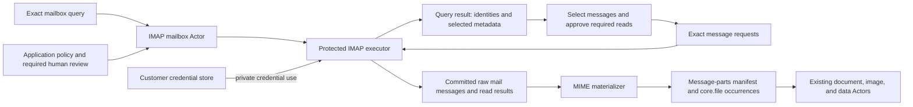

# IMAP mailbox Actors and message provenance

Status: target architecture with bounded query/selected-read contracts, an optional
credential database component and a host-only protected executor factory implemented.
Real TLS Dovecot/Qwen proofs cover shared review, installed Actors, raw publication
and bounded saved-mail materialization. An opt-in isolated local composition also
covers native settings and review denial. Hosted rollout and unattended synchronization
remain unqualified and disabled.

## Purpose

An Aven should be able to ask which messages match a question, read selected messages,
and process their attachments without receiving the mailbox password or access token.
Querying an inbox and downloading a message are separate capabilities with separate
disclosure limits. Reading mail must not mark it as read or authorize changing it.

Use the [customer credentials, authorization, and review
boundary](http-resource-actors.md#customer-credentials-and-discoverable-bindings) for
this work. The HTTP fetch Actor remains an HTTP resource reader. An **IMAP mailbox
Actor** exposes typed mail operations; its **protected IMAP executor** owns the
authenticated connection and credential handling. Ordinary Actors receive committed
results through the same runtime and Artifact Store ports used for other work.

The [shared Studio catalog contract](generic-actor-registry-and-runtime.md#studio-integration)
applies to query, message-read, and MIME capabilities. Once their schemas and
executable offers are installed, Studio and the solver discover them through the
authorized registry. Named collection/optional outputs, exact message selection,
review, and receipt-driven replanning require the shared binding and execution
extensions; they must not become mailbox-specific branches in Studio.



Folder discovery is optional: a query can name `INBOX` directly. A later bounded
folder-list capability may expose other mailboxes when authorized. A query does not
recursively enumerate folders, fetch every body, follow links, or start a monitor.

## Names and contract ownership

`ceo.aven` owns the `mail` domain. Include `imap` in transport-specific names; keep
`mail.message` independent of transport so an uploaded `.eml`, an IMAP capture, and a
future provider API can supply the same byte-processing interface with distinct
origins. A UI's “inbox” names a chosen mailbox, not a global data type or namespace.
Use the existing [identifier and evolution rules](http-resource-actors.md#identifier-forms-and-evolution).

The proposed Actor has manifest ID `imap-mailbox`, namespace `mail`, and version `1`:

| Operation | Method | Generated capability ID |
| --- | --- | --- |
| Query one mailbox | `imap_query` | `ceo.aven:capability:mail.imap-mailbox:imap_query@1` |
| Read one selected message | `imap_read_message` | `ceo.aven:capability:mail.imap-mailbox:imap_read_message@1` |

Its definition ID is `ceo.aven:actor:mail:imap-mailbox@1`. Both capabilities are
`observe` operations with `reconcilable` publication, not pure transformations or
exactly-once remote observations. A separate `ceo.aven:actor:mail:message-parts@1`
Actor exposes `mail_materialize_parts` as a byte-derived `transform`; its generated
capability is `ceo.aven:capability:mail.message-parts:mail_materialize_parts@1`.
It cannot authenticate to a mailbox or fetch remote resources.

The implemented first profile produces `mail.message-parts@1` with raw byte ranges
and separate file occurrences. It supports plain text, JSON, CSV, PDF, PNG and JPEG;
HTML, encrypted content and nested messages remain explicit unsupported parts in
the retained original. Decoded files carry causal input and exact source-range
evidence. Full nested-message decoding and broader media inspection below remain
extensions. Limits and the pinned parser are described in the
[mail component](../libs/aven-mail/README.md).

| Qualified schema ID | Store type/version | Blob | Meaning |
| --- | --- | --- | --- |
| `ceo.aven:schema:mail:imap-query@1` | `mail.imap-query@1` | none | Exact binding reference, mailbox, search criteria, requested metadata, and limits |
| `ceo.aven:schema:mail:imap-query-result@1` | `mail.imap-query-result@1` | none | Observed mailbox epoch, bounded matching UIDs/metadata, scan coverage, and observation interval |
| `ceo.aven:schema:mail:imap-message-request@1` | `mail.imap-message-request@1` | none | One selected account/mailbox/UIDVALIDITY/UID and bounded message read |
| `ceo.aven:schema:mail:imap-message-result@1` | `mail.imap-message-result@1` | none | `captured` with a structural reference to the new message, or `unavailable` with an explicit observation; never a fabricated empty message |
| `ceo.aven:schema:mail:message@1` | `mail.message@1` | required | Complete unmodified Internet-message bytes, including MIME encodings; no dependency on their acquisition transport |
| `ceo.aven:schema:mail:message-parts@1` | `mail.message-parts@1` | none | Versioned MIME interpretation, part paths, decoding outcomes, source locators, and structural references to derived files |
| `ceo.aven:schema:docs:file@1` (existing) | `core.file@1` | required | One decoded attachment or admitted body part, with its own occurrence and causal source |

These are proposed registrations with explicit bindings, not new aliases for HTTP
responses or Studio artifacts. Query metadata reports what the server returned; it
is not verified sender identity or a complete parsed email. The raw message's headers
remain captured content. A model's interpretation of them is another derived result.

The planner sees `ceo.aven.mail.imap_query_result(Q, R)` only after the query result
commits. `imap_read_message` guarantees a typed read result, not a message that might
have disappeared: its result projects `ceo.aven.mail.imap_message_result(F, R)`.
Only a committed `captured` result and its validated message reference make
`ceo.aven.mail.message(M)` available for MIME processing. Projectors validate the
production inputs and structural references behind these relations. Neither the
planner nor an Actor can assert them from an anticipated result or a copied UID.

## A bounded inbox query

A credential-free request can look like this; all fields are proposed, not an API
available today:

```json
{
  "bindingRef": "work-mail-binding",
  "mailbox": "INBOX",
  "purpose": "invoice-discovery",
  "criteria": {
    "internalDate": { "since": "2026-09-01", "before": "2026-10-01" },
    "fromContains": "billing@example.com",
    "seen": "any"
  },
  "metadata": ["internal-date", "size", "flags"],
  "order": "uid-ascending",
  "limits": { "maximumMatches": 100, "maximumCommands": 20, "maximumSeconds": 30 }
}
```

Version 1 supports a closed conjunction of optional internal-date bounds,
`fromContains`, `subjectContains`, and `seen: any|seen|unseen`. Empty criteria mean all
messages within the admitted scan bounds. Strings, result bytes, and criterion count
are bounded; unknown keys and invalid date ranges fail validation. The executor
compiles typed fields into its own IMAP commands using the negotiated string encoding.
It never concatenates an Actor-supplied search program or accepts raw commands.
Unsupported criteria fail explicitly rather than silently broadening the query.

The date fields map to IMAP's internal-date calendar-day comparison, with inclusive
`since` and exclusive `before`; they are not sender Date headers or precise UTC
instants. String search is server-defined matching, not proof of an authenticated
sender. `uid-ascending` is UID order, not chronological order by a header. The older
protocol's [search definitions](https://www.rfc-editor.org/rfc/rfc3501.html#section-6.4.4)
also describe these distinctions. “Find invoices” is a later classification of captured
messages; there is no portable IMAP invoice or attachment-type search promise.

The request contains an opaque binding reference, not a password, login string,
server-selected endpoint, or reusable grant. The host resolves the reference under
current customer/owner access, shows its authorized label for review, and pins its
revision and remote account identity. Discoverability alone cannot authorize a query.
Searching server-side body content is outside the first criteria set; downloading
bodies is outside the query capability. New metadata fields require an explicit
disclosure contract, particularly headers containing other people's personal data.

### Results are observations, not mailbox snapshots

An IMAP UID is stable only within its mailbox and UIDVALIDITY. Sequence numbers can
shift as messages disappear. The durable remote identity is therefore
`(accountRef, mailbox, uidValidity, uid)`. A `Message-ID` header can be absent or
duplicated and does not replace that tuple. `UIDNEXT` provides a bound on subsequently
assigned UIDs; it does not freeze message flags or prevent expunges.
[IMAP's identifier rules](https://www.rfc-editor.org/rfc/rfc9051.html#section-2.3.1.1)
are the basis for the following application contract.

On admission, the executor opens the authorized mailbox read-only and records
UIDVALIDITY and `upperUidExclusive = UIDNEXT`. It searches explicit numeric windows
below that fence. Limit each window so even every UID matching fits the remaining
match budget; `maximumMatches` alone does not bound the server's response. Empty
windows are handled locally; never emit a reversed UID range
or use `*` to mean a fixed upper bound. Reject results outside the admitted window,
duplicate/conflicting metadata, or unsupported nonpersistent UID behavior. Treat a
change of UIDVALIDITY as a new mailbox epoch requiring a new query and cursor.

The query result retains the exact query as a production input. Its payload records
the opaque account reference, mailbox, epoch, fence, explicit `scanFromUid`, searched
UID windows, requested metadata, start/end observation times, and coverage.

The first searched window starts exactly at `scanFromUid`; subsequent windows are
contiguous and end immediately before `nextUid`. An empty scan cannot advance that
cursor. A first page starts at 1; a continuation starts at its exact retained parent's
`nextUid`. A page can cover the remaining interval without claiming that this page
alone searched earlier UIDs. The protected adapter validates this relationship before
publication and preserves the preceding page as a causal input.

The coverage states are:

- `complete`: every window in the declared scope finished successfully and all
  matching UIDs were retained;
- `truncated`: a declared match, command, time, or result-byte bound stopped the scan
  between completed commands; retain the covered windows and stop reason;
- `incomplete`: a matching UID could not be resolved during metadata retrieval;
  retain its identity and missing-metadata outcome rather than silently omitting it.

Never turn a disconnected, rejected, or malformed command into an empty successful
query result. Such an attempt fails; it cannot claim coverage for that command. An
empty result means only that this successful query observed no matches in its declared
scope. Even complete coverage is a scan over an interval, not a transactionally
consistent mailbox snapshot. Metadata may change and messages may disappear between
search and metadata retrieval; record missing UIDs explicitly and mark coverage
incomplete rather than dropping them. Truncation is not “no more mail.”

Pagination creates a new query occurrence with the previous result as a causal input,
the same pinned account/mailbox/epoch and upper fence, and the next explicit UID
window. It rechecks authority and does not replay a server-local search variable or
an authenticated socket. A continuation is a query description, not authority. First
version queries always observe the server; offline search of already captured mail
is a separate local-artifact capability and cannot claim current inbox state.

## Read selected messages without changing the mailbox

Selection materializes one `mail.imap-message-request` per chosen UID, with the query
and exact query-result occurrence as causal inputs. The request includes the same
binding reference and remote identity tuple, purpose, and maximum raw byte count.
The adapter validates the selection against the result; a caller cannot substitute
another UID, mailbox, or account. An unavailable message does not authorize reading
the next one. Version 1 requires this query-backed selection; direct arbitrary-UID
requests are a separately admitted future contract.

A query match is historical evidence: an unread message can become read before its
capture. The read result records current observed metadata without rewriting the
query result. If policy requires the criteria still to hold, requery and obtain the
required review for the new selection instead of treating old flags as current.

The executor reopens the mailbox, verifies the requested UIDVALIDITY, then retrieves
only that UID. It uses `EXAMINE` and `UID FETCH` with `BODY.PEEK[]`; the latter avoids
implicitly setting `\Seen`. It accepts only a closed read-command allowlist, excluding
flag updates, copies, moves, append, expunge, mailbox administration, and mail sending.
These read semantics come from [EXAMINE](https://www.rfc-editor.org/rfc/rfc3501.html#section-6.3.2)
and [BODY.PEEK](https://www.rfc-editor.org/rfc/rfc9051.html#section-6.4.5).
Use implicit TLS with hostname/certificate verification and a pinned allowed host/port;
993 is the standard implicit-TLS IMAP port.
[TLS guidance](https://datatracker.ietf.org/doc/html/rfc8314#section-3.2)
supports this choice. No plaintext fallback, dynamic referral, or caller-selected proxy
is permitted. Hostname resolution and egress receive the same scrutiny as HTTP.

One successful read publication contains a new raw `mail.message` and a
`mail.imap-message-result` referencing it. Both share a production run whose exact
inputs include the message request and its query-result selection. Its receipt binds
the observed account/mailbox/epoch/UID, selected metadata, executor implementation,
observation interval, complete blob digest/length, and redacted authorization decision.
The message is staged before commit, preserving the complete fetched bytes without
newline normalization, MIME reserialization, or transfer decoding.

A successful command that returns no requested UID publishes an `unavailable` result,
without a message blob. It establishes that the UID was not returned by this read,
not why it disappeared. Transport, credential, epoch, protocol, size, or partial-body
failures publish no completed message. Streaming parsers enforce literal, line,
response, total-byte, and time limits before allocation. Partial fetches bind the UID,
offset, and expected total and reject gaps or inconsistent lengths; partial bytes are
never an ordinary `mail.message`.

Retries replay a committed publication for the same invocation. A new network attempt
gets fresh authorization and a new attempt identity; it cannot be described as replay
of an observation that never committed. An explicit new capture creates a distinct
occurrence even if its blob deduplicates. Version 1 does not silently select a cached
message as the result of a new remote read. Existing artifacts can still be processed
under their own artifact-read authority, retaining their original capture history.

## Shared credentials, protocol-specific authority

Use `ceo.aven:component:data:credentials@1` and its set-only lifecycle. An IMAP binding
has a protocol discriminator and a typed IMAP profile: allowed server/port/TLS mode,
login and authentication mechanism, stable opaque `accountRef`, exact permitted
mailboxes, allowed query/read operations, purposes, and limits. Login and server
details are sensitive metadata disclosed only where authorized; the ordinary Actor
needs only the binding reference and selected mailbox. Mailbox names are preserved
according to the negotiated protocol, not normalized as URL paths or generally
lowercased. Implicitly changing the remote account creates a new account reference;
rotation for the same verified account preserves it and advances the secret version.

The existing `CredentialBinding` type is HTTP-specific. Do not insert IMAP into its
GET/HEAD `methods` or header/cookie/query attachment union. The proposed stored binding
envelope discriminates `protocol: http|imap` and validates the appropriate profile;
the legacy HTTP interface adapts explicitly to the HTTP branch. Static password/app
password and an already obtained XOAUTH2 token are initial profile candidates. OAuth
consent, refresh, and long-lived delegated access remain separate lifecycle work.
An expired provider token requires renewed authority/material through the protected
ingress, never a secret in an Actor continuation.

The shared use-authorization schema binds the protocol, operation capability and
request schema, exact occurrence/store digest, normalized operation digest, account,
binding/secret revisions, mailbox and selected UIDs or query bounds, customer
generation, caller/parent invocation, executor audience, current session, review
decision, response-release policy, and cumulative budgets. HTTP authorization cannot
be replayed against an IMAP executor, or query authority against a body read. The
protected IMAP executor uses its own workload and
`ceo.aven:db-role:credentials:use-imap@1` role; the HTTP executor's `use-http` role
cannot resolve its bindings. Neither receives unrestricted ciphertext table access.
Guarded use functions and unwrap authorization enforce that division.

Unlike HTTP, one authenticated IMAP connection can execute many commands after login.
The connection is therefore secret-derived authority even when the password has been
discarded. Version 1 keeps it private to one bounded attempt and closes it on success,
failure, cancellation, expiry, or review wait; there is no Actor-visible session
handle or cross-invocation connection pool.

The durable claim unit is an IMAP command with an ordinal and canonical command
digest inside the authorized attempt. The digest covers the credential-free typed
command plan; authentication binds mechanism and credential version, never the raw
authentication bytes or a hash of the password/token. Authentication consumes a claim before secret
use; each subsequent mailbox/search/fetch command consumes its own claim and rechecks
current session, binding/secret revisions, revocation, and remaining budgets before
dispatch. Reusing a logged-in connection never bypasses those checks. A duplicate
claim cannot send again; uncertain sends require a fresh admitted attempt. Revocation
blocks claims ordered after it, while an already admitted command may finish.
Socket reads and chunking also obey the attempt's byte/time/cancellation bounds.
No raw authentication transcript, password, token, or live connection is retained.

## Human review and unattended work

Use the shared `os.aven:schema:actors:review-request@1`,
`os.aven:schema:actors:review-decision@1`, and `approval` continuation. The proposed
IMAP review subject is `ceo.aven:schema:mail:imap-credential-use-review@1`; it remains
private runner metadata, not an artifact or a second approval engine.

A query review shows the authorized account label, mailbox, criteria, returned
metadata, scan limits, retention/destination, and expiry. Permission to query does
not include downloading bodies. A message-read review binds the finite selected
request occurrences and their UIDs, per-message/total byte limits, intended processing
and model disclosure, retention, and bounded retries. Policy may group an already
known finite selection into one review for its parent invocation; each child read
still obtains authority for its exact request and shares the parent's budgets.
Unknown future matches are not silently added to that approval.

Denial, postponement, changed binding/account/epoch, or expired review prevents the
dependent read. Resume reauthenticates and revalidates the exact decision, then opens
a fresh connection. A message may disappear while a person decides; `unavailable` is
a valid outcome, not a reason to expand the selection. Missing credentials use the
existing input continuation and authenticated set-only ingress.

Mailbox connections, account metadata, approvals, and any future Source delegation
follow the [interactive customer selection boundary](generic-actor-registry-and-runtime.md#customer-selection-is-not-execution-authority).
Switching A → B invalidates interactive query/read selections and handles from A;
late query results and queued imports cannot populate or write B. Durable connection,
cursor, capture, and delegation records remain in A. The rail neither starts another
mailbox Source nor renews unattended authority. On returning to A, reacquire
interactive handles and revalidate the account, UIDVALIDITY, exact selection, and
current authority before a new read.

Case reconstruction searches retained messages through the shared workspace retrieval
interface. Missing or incompletely indexed mail is a coverage gap, not implicit
permission to contact the mailbox. A case confirmation, research-model review, or
old quoted approval cannot authorize query or body-read claims. Real trial queries
and reads follow the [shared trial boundary](http-resource-actors.md#recall-preview-and-trial-use),
including publication/cache isolation, exact mode/scope approval, and live per-command
authorization. Device/server handoffs preserve the server-only credential boundary.

Polling and IMAP IDLE are future Source-supervisor capabilities, not hidden loops
inside `imap_query`. They require bounded revocable delegated authority if no user
session is active. The Source owns its cursor and dispatch policy in the existing
runner repository. A UID watermark discovers additions but misses changes to older
messages, including a message becoming unread again. Store durable capture/dispatch
outcomes before advancing coverage; do not use `\Seen` as an ingestion checkpoint.

Flag/deletion synchronization needs a separate contract. Where supported,
CONDSTORE/QRESYNC can supply modification state and expunge information, but the
implementation must handle UIDVALIDITY resets and `NOMODSEQ` explicitly rather than
claiming universal incremental synchronization.
[RFC 7162](https://www.rfc-editor.org/rfc/rfc7162.html#section-3)
defines those extensions. Provider-token refresh and reconnect do not renew Aven
customer authority, and IDLE notifications do not replace captured message evidence.

Use the shared Source supervisor's capture ledger, subscription generations, causal
cycle checks and aggregate budgets. Query results, selections, MIME intermediates,
and other internal outputs can also match subscriptions; cycle protection must
consider them, not only the Skill's public result. Review/control records, synthetic
outcomes and trial publications cannot trigger ordinary capture or subscriptions.
Cancellation closes the private IMAP connection and prevents the next command claim;
an already transmitted command follows the declared uncertain-result/recovery rules.

## Provenance through MIME and attachments

The required chain is query → observed result → selected message request → committed
raw message → MIME interpretation → decoded file → extracted field. Each arrow is a
declared production input or the corresponding validated evidence relation. Skill,
Source, activation, and parent/child invocation evidence is retained when applicable.
Restricted audit identifies credential use without copying credential values into
that chain. Mail content is untrusted input, not instructions for the executor.

Publish the raw message before running MIME materialization. The MIME Actor consumes
that committed occurrence and produces a parts manifest plus new `core.file`
occurrences for admitted body parts and attachments. The manifest may reference those
files within its publication; every file's producer declares the raw message input.
Do not publish raw mail and extracted attachments as sibling outputs of one capture
and then claim that the raw mail was a preexisting causal input to extraction.

Record MIME part paths, bounded original header values, transfer/charset decoding,
parser version, and locators into the actual raw blob. MIME part paths alone are not
new kernel locator kinds: map them to byte ranges or JSON pointers into declared
intermediate artifacts using the existing evidence contract. Decoded bytes receive
their own digest; base64 or quoted-printable source bytes are not the attachment's
digest. Structured extracted fields retain evidence through any decoded text artifact
back to those parts and the original message. Invalid encodings and missing evidence
are explicit outcomes, never guessed successful extraction.

MIME parsing has independent memory, time, part-count, depth, decoded-byte, and filename
bounds and executes without network access. Nested messages and inline parts need
explicit paths. Unsupported encrypted content remains unavailable to extraction;
HTML links, remote images, archives, and active content do not execute implicitly.
A part-less or malformed message can produce a bounded inspection outcome with no
files; no model predicts that every email contains a useful document.

Equal attachment bytes in different messages, or different parts of one message,
remain distinct occurrences. Equal raw bytes in another mailbox or query invocation
do not merge arrival histories. Remote deletion does not delete captured artifacts;
retention and artifact access are separate policies. A malicious provider can return
secret-bearing content, so the protected executor applies the same admitted-provider
and response-release constraints as HTTP; provenance certifies the recorded path,
not message authorship, truth, or arbitrary-provider secrecy.

## Existing code and integration requirements

The [local IMAP/PDF prototype](operations/imap-pdf-prototype.md) already supplies
read-only TLS acquisition, UID-based identity, bounded partial downloads, MIME/PDF
extraction, and tests. It keeps credentials in local process/application memory and
raw messages in a local cache. The desktop uploads PDFs as ordinary files with source
labels, not complete raw-email Artifact Store lineage. It is groundwork, not the
protected server Actor or the publication contract specified here.

The `continuous-email-worker-design` worktree implements Studio Sources, immutable
Skill definitions, activations, and `studio.email@1` synthetic messages. Keep those
identities and explicit provenance. Its synthetic fixture publishes raw mail and an
attachment as sibling outputs, and its publication adapter still supplies empty
field evidence. That fixture does not prove a parser's raw-message-to-attachment
lineage. Register `mail.message` for new captures. Studio's clean v2 cutover requires
no old Skill reader or automated mail-fixture conversion. Retained old artifacts
remain immutable history. If a separately requested import reuses an old raw blob,
record that exact occurrence as an input to the new `mail.message` and publish MIME
derivation separately. Do not rename stored `studio.email@1` definitions in place or
invent extraction evidence for old fixtures. This spec does not change that worktree.

The combined artifact library lists `core.file` sources and selected validated
representations. Its email-specific SQL projection recognizes `core.email`; that
name is not an alias for the proposed raw `mail.message` contract. Add explicit
read projections for new mail records where needed, without relabeling old values
or flattening MIME ancestry into presentation metadata. Materialized attachments
already use the shared file interface and must retain their committed raw-message
input. Follow the [exact library binding rules](generic-actor-registry-and-runtime.md#artifact-library-and-exact-source-bindings):
selecting an attachment or derived row preserves that exact occurrence, and opening
the library or a retained message never performs a new mailbox read.

Implementation depends on the shared Studio/runtime integration specified above,
including executable review and multiple-output bindings. The later Studio tree
already has a shared authorized catalog and finite v2 invoke/child execution;
observation branches, collection execution, durable review and unattended supervision
remain gated. Extend those existing installations and ports while preserving shared
budgets and invocation identities, then proceed as these bounded pieces:

1. Register mail schemas and projectors; prove query-result/selection identity and
   explicit schema-to-store bindings without touching the existing HTTP contracts.
2. Add typed IMAP binding profiles, protocol-specific use roles, command claims, and
   the fixed server proxy/executor. Reuse the customer component and key lifecycle.
3. Integrate query and selected-message reads with shared review and durable attempts.
   Preserve raw-message blobs and publish exact query/capture provenance.
4. Add deterministic MIME materialization and field evidence; route new Studio and
   desktop imports through committed source artifacts before claiming this lineage.
   Actor discovery and dispatch use the shared registry path.
5. Specify delegated Source supervision and incremental synchronization separately.
   Flag changes, moves, deletion, and sending remain separately named effect contracts.

Before enabling customer mail, verify credential isolation, cross-protocol grant
rejection, unchanged unread flags, UIDVALIDITY resets, empty/reversed UID bounds,
truncated queries, arrivals/expunges during search and review, malformed/oversized
literals, exact-byte capture, retries across crashes, per-command revocation, nested
MIME evidence, and identical attachments with distinct origins. Include both supported
protocol revisions and explicit rejection of unsupported authentication/encoding
profiles. Prove the shared Studio acceptance cases with query results containing
zero, one, and several messages, disappearance before a selected read, and review
inside a nested Skill. The committed query, selection, raw message, MIME part, file,
and downstream results must remain traceable without changing Studio source.
Include one owner switching A → B → A during query, review, and import: old results
must not reappear, attachments retain their original customer, and Source delegation
cannot transfer or renew through the selector.
Prove that case search does not acquire new mail, trial output cannot trigger productive
work, and internal MIME/query outputs cannot create recursive subscription admissions.
Documentation checks alone establish none of these runtime guarantees.
